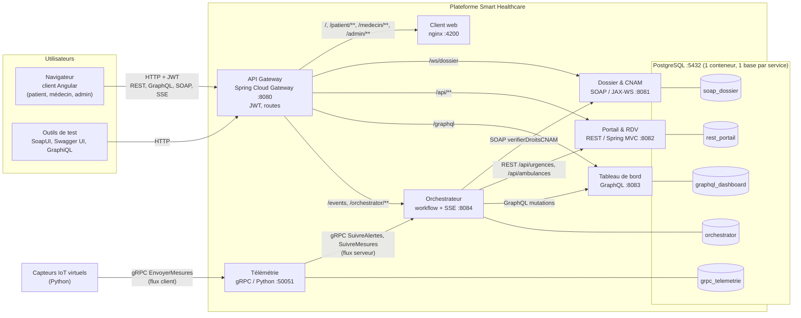

# Architecture microservices

Une seule porte d'entrée (la gateway), quatre services qui ne s'appellent jamais entre eux, et un orchestrateur qui est
le seul à enchaîner les appels (couplage lâche, D5). Chaque service a sa propre base dans le même conteneur PostgreSQL.

| Composant | Techno | Rôle | Contrat |
|---|---|---|---|
| API Gateway | Spring Cloud Gateway (WebFlux) | Seul port publié ; émet et vérifie le JWT ; routes vers les services et le client | — (D43, D44, D51) |
| Client web | Angular 21 servi par nginx | Écrans patient, médecin (alertes en direct), administrateur | — (D48–D50) |
| Dossier & CNAM | Spring Boot + Apache CXF | Droits CNAM, feuilles de soins, historique certifié, comparaison de garanties | WSDL + XSD |
| Portail & RDV | Spring Boot + Spring MVC + JPA | Créneaux, rendez-vous, profil, ordonnances, urgences, ambulances | OpenAPI |
| Tableau de bord | Spring for GraphQL + JDBC | Vue consolidée des patients : constantes, alertes, couverture, fiches | SDL |
| Télémétrie | Python + grpcio | Reçoit les mesures, détecte et diffuse les alertes | `.proto` |
| Orchestrateur | Spring Boot | Workflow de prise en charge, relais des constantes, flux SSE, trace | SSE, OpenAPI de la trace |
| Capteurs IoT | Python | Scénarios de mesures (normal, alertes, afflux) | `.proto` |

Règle d'architecture : aucun service ne lit la base d'un autre ni ne l'appelle ; seul l'orchestrateur relie
SOAP, REST, GraphQL et gRPC.
