# Déploiement Docker

Chaque composant a son Dockerfile (construction en plusieurs étapes, contexte = racine du dépôt pour accéder à
`contracts/`) ; `docker compose up -d --build` lance toute la plateforme. Seuls deux ports sont publiés sur l'hôte :
la gateway et PostgreSQL (outils d'administration). Les services se joignent par leur nom de conteneur sur le réseau
interne de compose.

| Conteneur | Image de base (D42, D51) | Port interne | Publié | Démarre après |
|---|---|---|---|---|
| postgres | `postgres:18.7-alpine` | 5432 | 5433 | — (contrôle de santé `pg_isready`) |
| soap-dossier | `eclipse-temurin:21.0.9_10-jre-noble` | 8081 | non | postgres (sain) |
| rest-portail | `eclipse-temurin:21.0.9_10-jre-noble` | 8082 | non | postgres (sain) |
| graphql-dashboard | `eclipse-temurin:21.0.9_10-jre-noble` | 8083 | non | postgres (sain) |
| grpc-telemetrie | `python:3.12.16-slim-bookworm` | 50051 | non | postgres (sain) |
| orchestrator | `eclipse-temurin:21.0.9_10-jre-noble` | 8084 | non | postgres (sain), 4 services |
| web-client | `node:20.19.5-slim` (build) → `nginx:1.30.7-alpine3.24` | 4200 | non | — |
| gateway | `eclipse-temurin:21.0.9_10-jre-noble` | 8080 | `${GATEWAY_PORT:-8080}` | services + client web |
| iot-simulator | `python:3.12.16-slim-bookworm` | — | non | grpc-telemetrie ; lancé par `docker compose run` |

Configuration uniquement par variables d'environnement (adresses `http://<conteneur>:<port>`, bases
`jdbc:postgresql://postgres:5432/<base>`, secrets de développement surchargeables) ; les bases et leurs utilisateurs
sont créés au premier démarrage du volume par `infra/postgres/init/01-bases.sql`.
