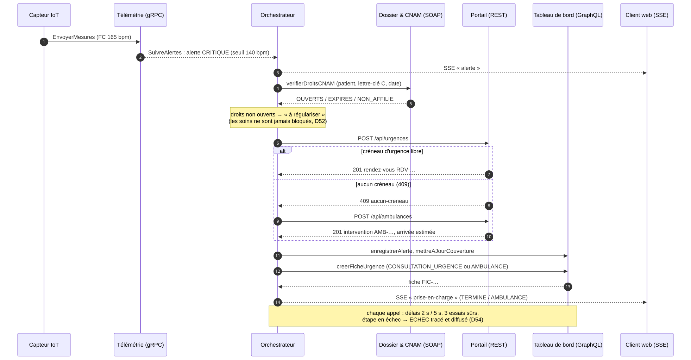

# Workflow de prise en charge d'une alerte

Le processus métier est modélisé en **BPMN 2.0** dans [`workflow-prise-en-charge.bpmn`](workflow-prise-en-charge.bpmn)
(à ouvrir dans Camunda Modeler ou sur https://demo.bpmn.io). Il est exécuté par le code de l'orchestrateur
(`WorkflowAlerte`, orchestration codée, D9), et chaque instance est tracée (`GET /orchestrator/workflows`, D54).

Le diagramme de séquence ci-dessous montre le même scénario, message par message.

| Étape (trace) | Service | Opération | Nouvel essai si panne |
|---|---|---|---|
| ALERTE_RECUE | gRPC | `SuivreAlertes` (niveau ≥ URGENT) | — (reconnexion toutes les 5 s) |
| DROITS_CNAM | SOAP | `verifierDroitsCNAM` | oui (lecture) |
| CRENEAU_URGENCE | REST | `POST /api/urgences` (REFUS = 409) | seulement si la requête n'est pas partie |
| AMBULANCE | REST | `POST /api/ambulances` | seulement si la requête n'est pas partie |
| ALERTE_TABLEAU_DE_BORD | GraphQL | `enregistrerAlerte` | oui (idempotent) |
| COUVERTURE | GraphQL | `mettreAJourCouverture` | oui (idempotent) |
| FICHE_URGENCE | GraphQL | `creerFicheUrgence` | seulement si la requête n'est pas partie |
